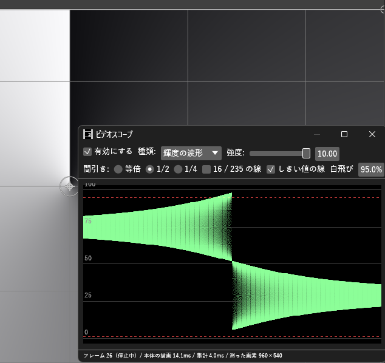

# VideoScope_H マニュアル

**VideoScope_H（ビデオスコープ）** は、今のフレームの**輝度の波形・RGB パレード・RGB の重ね・ベクトルスコープ・ヒストグラム**をウィンドウに描く汎用プラグインです。
色補正や素材同士の明るさ合わせを、目ではなく数値の分布で揃えるときに使います。
プロジェクトを書き換えることはありません

- **バージョン:** 0.2.0
- **作者:** by HexBrowns
- **必要環境:** AviUtl2 **2.1.11** 以上

---

## 開き方

- **表示** メニュー → **ビデオスコープ**

## 導入

1. `Plugin\VideoScope_H\VideoScope_H.aux2` を配置する。
2. AviUtl2を起動する。
3. **表示** メニュー → **ビデオスコープ** でウィンドウを開く。

---

## 使い方

1. ウィンドウを開き、**種類** を選ぶ。
2. カーソルを動かすと、そのフレームを測って描き直す。
3. 再生中も追従させるなら、シーンに **フルサイズプレビュー受け口** を置く（下の「再生中」）。

測るのは本体のプレビューと同じ合成結果です。

## 種類

| 種類       | 見えるもの                                               |
| -------- | --------------------------------------------------- |
| 輝度の波形    | 横が画面の左右、縦が輝度。点が明るいほど、その明るさの画素が多い                    |
| RGB パレード | R・G・Bの波形を左・中・右に並べたもの                                |
| RGB の重ね  | R・G・Bの波形を重ねたもの。3 つが重なる所は白くなる                        |
| ベクトルスコープ | 色相と彩度の分布。中心が無彩色、外ほど彩度が高い。75%と100%のカラーバーの目標と、肌色の線を引く |
| ヒストグラム   | 横が値（0〜100%）、縦が画素の数。R・G・Bを重ね、輝度を白い線で描く               |

ヒストグラムの高さは、両端を除いた一番高い山に合わせます。白飛び・黒潰れの山は上で切れます。

## 設定

| 項目          | 範囲             | 初期値          | 説明                                       |
| ----------- | -------------- | ------------ | ---------------------------------------- |
| 有効にする       | オン / オフ        | オン           | オフの間は本体に描画を頼まない。重いシーンで切る                 |
| 種類          | 上の 5 つ         | 輝度の波形        |                                          |
| 強度          | 0.10〜10.00     | 1.00         | 点の明るさ（ヒストグラムでは高さ）の倍率                     |
| 間引き         | 等倍 / 1/2 / 1/4 | 1/2          | 測る画素を縦横何画素ごとに拾うか。1/2 で 4 分の 1 の画素を測る     |
| 16 / 235 の線 | オン / オフ        | オフ           | 限定範囲（16〜235）の目安の点線。ベクトルスコープでは出ない         |
| しきい値の線      | オン / オフ        | オフ           | レンジ警告_Hの白飛びしきい値・黒潰れしきい値の点線。ベクトルスコープでは出ない |
| 白飛び / 黒潰れ   | 0.0〜100.0%     | 99.0% / 1.0% | しきい値の線がオンのときだけ出る。レンジ警告_Hの値に合わせる          |

レンジ警告_Hの判定方式が **チャンネル極値**ならRGB パレードの線、**輝度** なら輝度の波形の線が、それぞれの判定に当たります。

設定は保存されません。

ウィンドウの下の行に、測ったフレーム・状態・本体の描画にかかった時間・集計にかかった時間・測った画素の数を出します。

## 再生中

再生中は、プラグイン **FullSizePreview_H**の **フルサイズプレビュー受け口** が読んだ画面を受け取って描きます。

1. FullSizePreview_Hの最新バージョンを入れる（https://github.com/HexBrowns/FullSizePreview_H ）。
2. **編集** メニュー → **フルサイズプレビュー受け口を置く** で、再生するシーンに受け口を置く。
3. ビデオスコープを出したまま再生する。

| 下の行の表示                                               | 意味                                              |
| ---------------------------------------------------- | ----------------------------------------------- |
| 再生中（受け口から）                                           | 受け口から届いている                                      |
| 再生中はFullSizePreview_H v0.6.0 以降の「フルサイズプレビュー受け口」が要ります | 1 秒たっても届かない。受け口が無いか、FullSizePreview_Hが古い        |
| 受け口から空の画面が届いています                                     | 受け口がカメラ制御の対象に入っている。受け口を選び、設定欄の **カメラ制御の対象** を外す |

受け口は、ビデオスコープを出して再生しているときだけ画面を読みます（フルサイズプレビューのウィンドウが閉じていても読みます）。それ以外のときは何もしないので、置いたままでも編集やファイル出力は重くなりません。出力中は更新しません。

## 注意

- 値は 8bit で受け取るので、0〜100% の外は測れません
- ウィンドウが見えていない間は本体に何も頼みません
